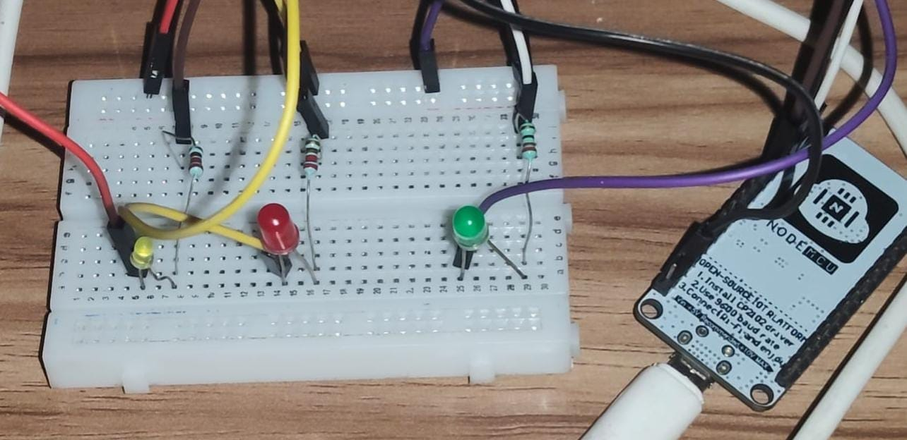
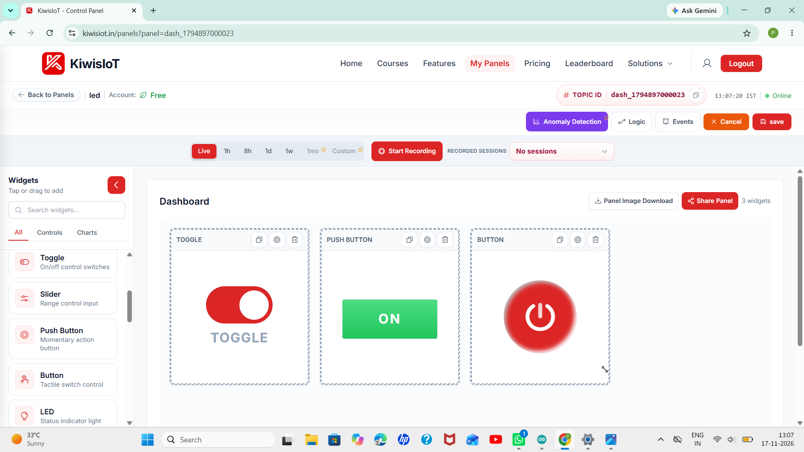

# 💡 LED Control Using NODEMCU ESP8266 with KiwisIoT Platform

## 📌 Project Overview

This project demonstrates controlling three LEDs using the NodeMCU ESP8266 and KiwisIoT platform.

The LEDs can be turned ON and OFF remotely through the KiwisIoT dashboard using a Wi-Fi connection.

## 🎯 Objective

- To understand IoT-based LED control.
- To connect NodeMCU ESP8266 to Wi-Fi.
- To control LEDs remotely using KiwisIoT.
- To understand communication between hardware and an IoT platform.

## 🧰 Components Required

- NodeMCU ESP8266
- 3 LEDs
- 3 Resistors
- Breadboard
- Jumper Wires
- USB Cable

## 💻 Software Requirements

- Arduino IDE
- ESP8266 Board Package
- KiwisIoT Library
- KiwisIoT Platform

## ⚙️ Working Principle

1. NodeMCU ESP8266 connects to Wi-Fi.
2. KiwisIoT establishes communication with NodeMCU.
3. Three LEDs are connected to the NodeMCU.
4. The KiwisIoT dashboard provides ON/OFF controls.
5. When a control is activated, the corresponding LED turns ON.
6. When the control is deactivated, the corresponding LED turns OFF.

## 🔌 Hardware Used

- LED 1
- LED 2
- LED 3
- NodeMCU ESP8266

## ☁️ KiwisIoT Platform

KiwisIoT is used to remotely control the three LEDs through an online dashboard.

Each LED is controlled using its respective channel.

## 📚 Learning Outcomes

- Learned basic IoT concepts.
- Learned ESP8266 Wi-Fi connectivity.
- Understood remote hardware control.
- Learned to use the KiwisIoT platform.
- Practiced Arduino programming and GPIO control.

## Output
[led.ino](led.ino)

## images

